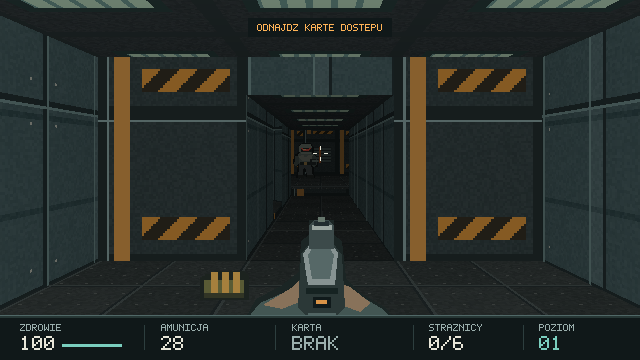

# USKOK — Protokół awaryjny

USKOK to silnik retro FPS w C++20 z autorskim poziomem demonstracyjnym. Program rysuje klatkę 640 × 360 pikseli na CPU. Mapa składa się z wypukłych sektorów o własnych wysokościach i oświetleniu. Wspólne krawędzie tworzą przejścia, przez które widać kolejne pomieszczenia. Ściany mogą biec pod dowolnym kątem.

Demo zawiera sześciu strażników, broń, amunicję, apteczki, zamkniętą gródź i automapę. Znajdź kartę dostępu w bocznym pomieszczeniu, otwórz gródź i dotrzyj do wyjścia w części reaktora.



## Budowanie i uruchamianie

Do kompilacji potrzebny jest kompilator C++20. Do uruchomienia okna potrzebna jest biblioteka uruchomieniowa SDL2. Silnik ładuje ją dynamicznie i używa jej do obsługi okna, wejścia i dźwięku.

**Linux (Debian/Ubuntu)**

Zainstaluj pakiety `g++`, `make` i `libsdl2-2.0-0`. W katalogu projektu uruchom:

```sh
make
./uskok
```

**Windows**

Zainstaluj Visual Studio z narzędziami C++ i CMake. W konsoli Visual Studio uruchom:

```powershell
cmake -S . -B build
cmake --build build --config Release
```

Umieść `SDL2.dll` dla architektury programu obok `build\Release\uskok.exe`, a następnie uruchom ten plik. CMake kopiuje mapę do katalogu programu.

**Klatka bez okna**

To polecenie zapisuje obraz PPM i działa także bez SDL2:

```sh
./uskok --capture klatka.ppm
```

Dodaj `--title`, by zapisać ekran tytułowy. Argument `--map ścieżka.map` ładuje wskazany poziom.

## Sterowanie

| Klawisz | Działanie |
| --- | --- |
| Enter | Start, wznowienie lub restart po zakończeniu |
| W / S, strzałki góra / dół | Ruch do przodu i do tyłu |
| A / D | Krok w bok |
| Mysz, strzałki lewo / prawo | Obrót |
| Shift | Bieg |
| Lewy przycisk myszy lub spacja | Strzał |
| E | Otwarcie grodzi, gdy stoisz blisko i patrzysz na nią |
| Tab | Automapa |
| Esc | Pauza i zwolnienie myszy |
| Q | Wyjście w menu lub podczas pauzy |

## Edycja mapy

Plik `usk.map` jest tekstowy. Linie zaczynające się od `#` zawierają komentarze. Identyfikatory sektorów odpowiadają kolejności ich deklaracji i zaczynają się od zera.

| Zapis | Znaczenie |
| --- | --- |
| `sector podłoga sufit światło liczba_punktów x y materiał …` | Wypukły wielokąt o dodatnim polu skierowanym. Podaj po jednej trójce na wierzchołek. Materiał dotyczy krawędzi do następnego wierzchołka. |
| `spawn sektor x y kąt` | Jedno miejsce startu. Kąt 0° wskazuje dodatnią oś X, a 90° dodatnią oś Y. |
| `door sektorA sektorB` | Gródź na pojedynczej wspólnej krawędzi wskazanych sektorów. |
| `thing typ sektor x y` | Obiekt typu `guard`, `key`, `ammo`, `health` lub `exit`. |

Materiały ścian to `s` (stal), `r` (rdza), `h` (oznaczenia ostrzegawcze) i `c` (panele reaktora). Wspólna krawędź musi mieć te same końce w odwrotnej kolejności. Jeśli przejście zajmuje fragment dłuższej ściany, podziel ścianę, dodając wierzchołki w obu narożnikach przejścia. Wnętrza sektorów powinny być rozłączne. Dla przejść gracza różnica wysokości podłóg może wynosić najwyżej 0,49 jednostki, a wspólny prześwit musi mieć co najmniej 1,68 jednostki.

## Kod

- `src/engine.cpp` ładuje mapę, wyznacza przecięcia z krawędziami, rozwiązuje kolizje i aktualizuje stan gry.
- `src/render.cpp` śledzi jeden promień na kolumnę ekranu. Otwór portalu ogranicza zakres widocznych pikseli następnego sektora. Bufor głębokości na piksel zasłania sprite’y według geometrii. Tekstury, sprite’y i czcionka są generowane w kodzie.
- `src/platform.cpp` prezentuje gotowy bufor, zbiera sterowanie i odtwarza syntetyczne efekty dźwiękowe.
- `src/main.cpp` obsługuje uruchamianie gry i zapis klatki.

Format mapy opisuje geometrię 2,5D. Każdy sektor ma płaską podłogę i płaski sufit oraz jedno wnętrze na danej pozycji XY.
